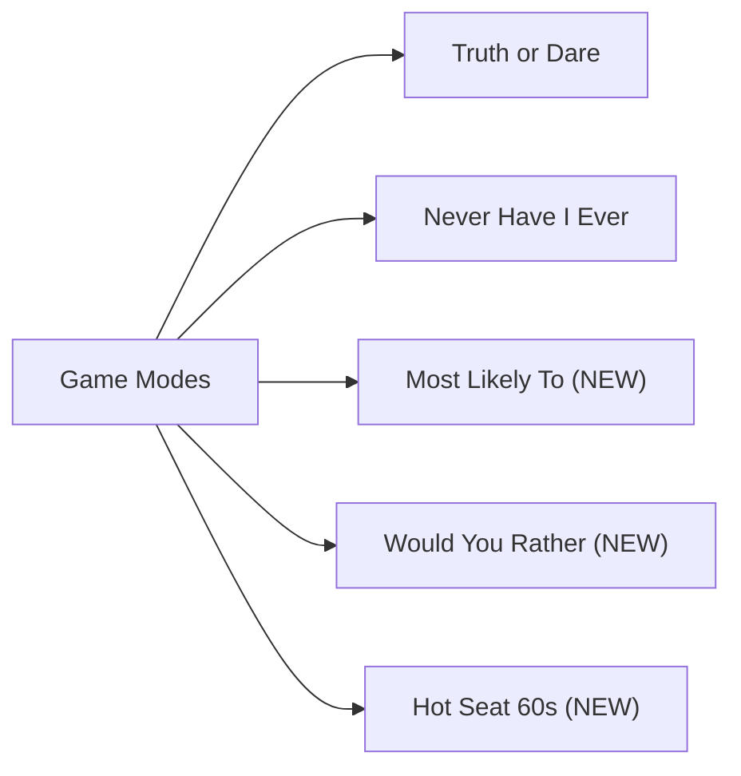

# All★Star Infinity — Feature & Roadmap Suggestions
### Handcrafted, 100% Offline-First Party Engine

---

## 🎯 Executive Summary
All★Star Infinity has an exceptional foundation: **19 distinct visual themes**, a slot-based architecture, a unified deck manager, and 225 handcrafted prompts. Because the app is strictly **100% handcrafted and offline-first**, the key to making it the ultimate party app lies in **multiplayer party mechanics, tactile sensory feedback, game mode diversity, and seamless player-to-player deck sharing**.

---

## 🚀 Category 1: High-Impact Gameplay Enhancements (Enhance Existing)

### 1. 👥 Pass & Play Player Roster Mode
* **Current state:** Single generic screen; players manually pass the phone or read aloud without the app tracking turns.
* **Proposed Enhancement:**
  - Simple player setup before starting: add names (e.g. "Alex", "Sam", "Jordan").
  - On each turn, the app announces: **"Alex, it's your turn!"**
  - Adds target customization: *"Alex, dare Jordan to..."*
  - Optional penalty counter or "Chicken Count" (tracks who chickened out and took the penalty).

### 2. ⏱️ Tension Countdown Timer
* **Current state:** Prompts sit statically until the next button is tapped.
* **Proposed Enhancement:**
  - An optional 15s / 30s countdown bar for answering Truths or accepting Dares.
  - Visual pulse as time runs out (turns red, shakes).
  - Buzzer sound effect / heavy vibration when time expires, forcing the player into the penalty!

### 3. 🍻 Party Rule Preset Toggle (Sips vs. Physical Dares)
* **Current state:** Penalties are mixed (some say "Do jumping jacks", others "Take a sip").
* **Proposed Enhancement:**
  - Mode selector at the start:
    - **Sober / Family Friendly:** Purely physical, silly, and social penalties.
    - **College / Drinking Party:** Automatically adapts penalties into sips, shots, or drink rules.
    - **Underground / High Stakes:** Extreme social and daring penalties.

---

## 🌟 Category 2: New Game Modes (Add New)

Currently, the app supports **Truth or Dare** and **Never Have I Ever**. These 3 additional modes fit seamlessly into the existing 3-intensity structure:

### 1. 🗳️ "Most Likely To"
- **How it works:** App presents a statement (e.g. *"Most likely to wake up in another country with no memory"*).
- On the count of 3, everyone points at someone in the room.
- The person with the most votes takes the penalty or completes the dare!

### 2. ⚖️ "Would You Rather"
- **How it works:** Two equally cursed or hilarious choices (e.g. *"Fight 100 chicken-sized ducks OR 1 duck-sized chicken"* / spicy dilemmas in Hot & Vulgar).
- Everyone votes simultaneously. Minorities drink or do a forfeit.

### 3. 🔥 "The Hot Seat" (Speedrun)
- **How it works:** One player is put on the spot for 60 seconds.
- The group fires rapid prompts that the player must answer within 3 seconds without hesitating.

---

## 📱 Category 3: Tactile & Audio Immersion

### 1. 📳 Native Haptic Feedback (`@capacitor/haptics`)
Tactile feedback elevates a mobile party game significantly:
- **Card Swipe:** Subtle tick vibration when sliding cards in `DeckCarousel`.
- **Card Draw:** Medium thud when tapping Truth or Dare.
- **Vulgar Reveal:** Heavy double-pulse heartbeat vibration when drawing a Vulgar prompt.
- **Timer Warning:** Rapid micro-pulses in the final 5 seconds.

### 2. 🎵 Procedural Retro Sound FX (Web Audio API)
- Purely synthetic/procedural sounds generated in code (0 external audio files needed):
  - Card flip whoosh
  - Countdown ticking
  - Penalty fail buzzer
  - Victory / celebration chime
- Toggle switch in Settings tab: **Sound Effects [ON / OFF]**.

---

## 📦 Category 4: Deck & Community Sharing (Modify / Expand)

### 1. 📲 Export / Import Decks via QR Code or Short Code
* **Current state:** Custom decks exist only in the device's local storage.
* **Proposed Enhancement:**
  - **Export Deck:** Generates a compressed Base64 string or renders an offline QR code on the screen.
  - **Import Deck:** Another phone scans the QR code or pastes the code to instantly add the deck to their local collection.
  - **100% Offline:** No database, accounts, or servers required!

### 2. 🗂️ Pre-Built Themed Deck Packs
Add curated built-in bonus decks users can activate:
- **"Couples Romance"** (Tender truths & sweet dares)
- **"Late Night Dorm"** (College chaos & gossip)
- **"Gamer Trivia & Rants"** (Hot takes on games, anime, and pop culture)

---

## 🎨 Category 5: Theme System Polish

### 1. 🖼️ Realm Selection Preview Cards
* **Current state:** `MainMenu.tsx` has text buttons on skew angles.
* **Proposed Enhancement:** Add mini visual badge cards with theme colors, icon badges, and styled typography previewing the aesthetic before selecting.

### 2. 🌓 "Easy Font" Global Persistence
* **Current state:** Persona theme has an "Easy Font" toggle, but other stylized themes (VT323, Courier, Gothic) don't have a universal toggle.
* **Proposed Enhancement:** Move `useEasyFont` to universal Settings so players with readability preferences can use clean sans-serif across all 19 themes.

---

## 📋 Suggested Priority Implementation Order

| Priority | Feature | Effort | Impact |
|---|---|---|---|
| **Phase 1** | Capacitor Haptics integration (`@capacitor/haptics`) | Low (1-2 hrs) | ⭐⭐⭐⭐⭐ Huge tactile feel |
| **Phase 2** | Pass & Play player turn tracker | Medium (3-4 hrs) | ⭐⭐⭐⭐⭐ Party gameplay flow |
| **Phase 3** | Countdown timer on prompts (optional 15s/30s) | Low (1-2 hrs) | ⭐⭐⭐⭐ High party tension |
| **Phase 4** | "Most Likely To" game mode | Medium (2-3 hrs) | ⭐⭐⭐⭐ Expands replayability |
| **Phase 5** | Deck Export / Import (QR code & string) | Medium (3 hrs) | ⭐⭐⭐⭐⭐ Word-of-mouth sharing |
